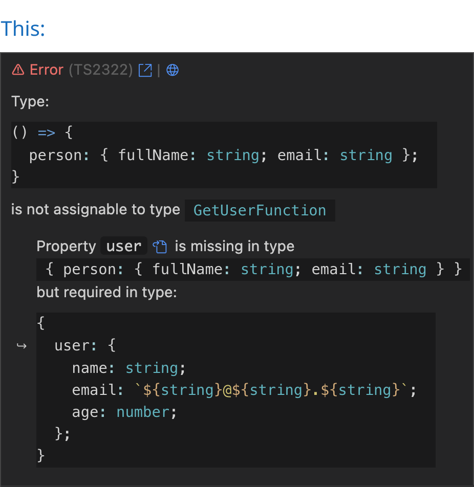
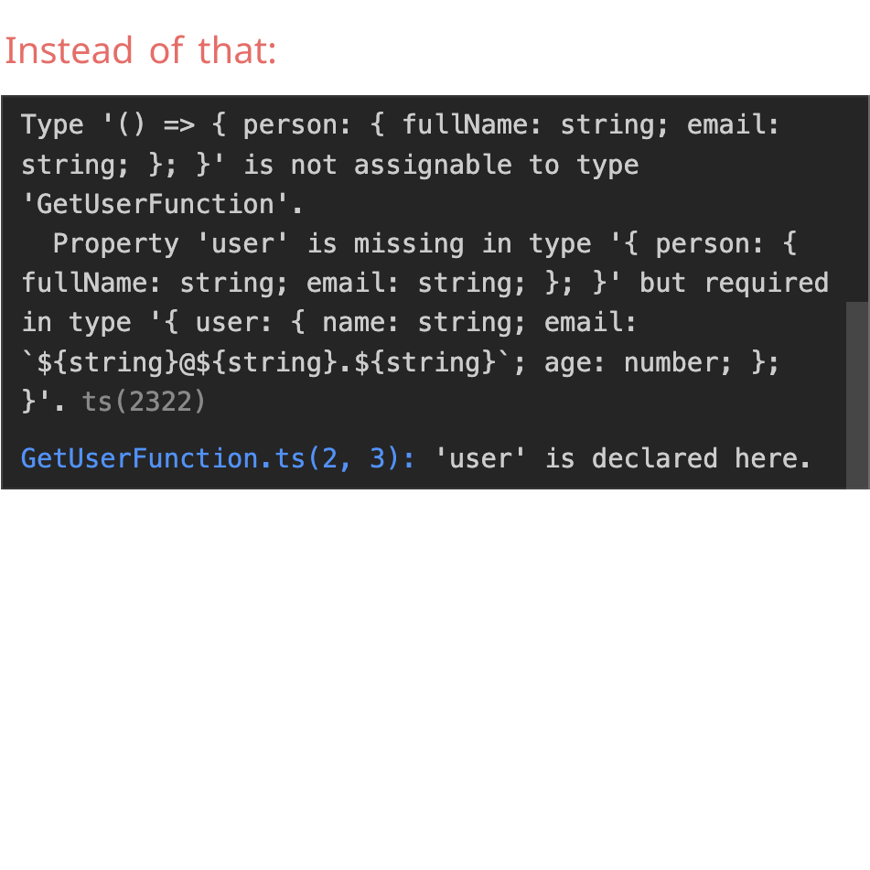
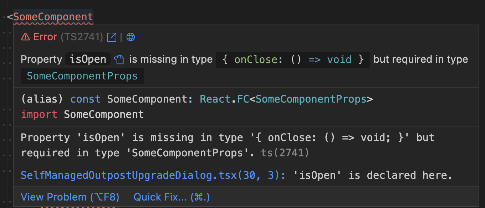

> **语言**：本文档为简体中文翻译，[点此查看英文原版 README.md](README.md)。

<a href="https://marketplace.visualstudio.com/items?itemName=yoavbls.pretty-ts-errors" style="display: none;">
  <picture>
    <source media="(prefers-color-scheme: dark)" srcset="https://raw.githubusercontent.com/yoavbls/pretty-ts-errors/main/assets/icon.png" width="140">
    <source media="(prefers-color-scheme: light)" srcset="https://raw.githubusercontent.com/yoavbls/pretty-ts-errors/main/assets/icon.png" width="140">
    
  </picture>
</a>

# Pretty `TypeScript` Errors

<b>让 VSCode 中的 TypeScript 错误更美观、更易读。</b>

[](https://GitHub.com/yoavbls/pretty-ts-errors/stargazers/)
[](https://marketplace.visualstudio.com/items?itemName=yoavbls.pretty-ts-errors)&nbsp;[](https://github.com/yoavbls/pretty-ts-errors/blob/main/LICENSE)&nbsp;[](https://marketplace.visualstudio.com/items?itemName=yoavbls.pretty-ts-errors)
<a href="https://github.com/yoavbls/pretty-ts-errors/discussions/43#user-content-jetbrains-support"></a>
[](https://open-vsx.org/extension/yoavbls/pretty-ts-errors)

随着类型复杂度的增加，TypeScript 错误会变得越来越乱。到了某个程度，TypeScript 就会朝你甩出一堆乱七八糟的括号和 `"..."`。
这个扩展能帮你搞明白到底发生了什么。举个例子，面对下面这个相对简单的错误：

&nbsp; &nbsp; 

## 观看视频

<a href="https://www.youtube.com/watch?v=9RM2aErJs-s" target="_blank">
 
</a>

以及来自以下频道的视频：
[Web Dev Simplified](https://www.youtube.com/watch?v=ccg-erZYO4k&list=PL0rc4JAdEsVpOriHzlAG7KUnhKIK9c7OR&index=1),
[Josh tried coding](https://www.youtube.com/watch?v=_9y29Cyo9uU&list=PL0rc4JAdEsVpOriHzlAG7KUnhKIK9c7OR&index=3),
[trash dev](https://www.youtube.com/watch?v=WJeD3DKlWT4&list=PL0rc4JAdEsVpOriHzlAG7KUnhKIK9c7OR&index=4&t=208),
以及[更多](https://www.youtube.com/playlist?list=PL0rc4JAdEsVpOriHzlAG7KUnhKIK9c7OR)

## 特性

- 错误信息中的类型会按你主题的颜色做语法高亮，同时支持浅色与深色主题
- 在错误信息的类型旁边有一个按钮，可带你跳转到相应的类型声明
- 有一个按钮带你跳转到 [typescript.tv](http://typescript.tv) 上的对应错误，那里有详细解释，有时还配有视频
- 有一个按钮带你跳转到 [ts-error-translator](https://ts-error-translator.vercel.app/)，在那里你可以用通俗易懂的英文阅读该错误

## 支持范围

- Node 和 Deno 的 TypeScript 错误报告器（在 `.ts` 文件中）
- JSDoc 类型错误（在 `.js` 和 `.jsx` 文件中）
- React、Solid 和 Qwik 错误（在 `.tsx` 和 `.mdx` 文件中）
- 启用了 TypeScript 时的 Astro、Svelte 和 Vue 文件（在 `.astro`、`.svelte` 和 `.vue` 文件中）
- Ember 和 Glimmer 的 TypeScript 错误，以及由 Glint 报告的模板问题（在 `.hbs`、`.gjs` 和 `.gts` 文件中）

## 安装

```
code --install-extension yoavbls.pretty-ts-errors
```

或者直接在 [VSCode marketplace](https://marketplace.visualstudio.com/items?itemName=yoavbls.pretty-ts-errors) 中搜索 `pretty-ts-errors`

#### 如何隐藏原始错误并让类型可复制

请按照[这里](./docs/hide-original-errors.md)的说明操作。很遗憾，由于 VSCode 的限制，这个 hack 是必需的。

## 为什么这事儿并不简单

1. TypeScript 错误里包含的类型在 TypeScript 中并不是合法的。
   是的，这些类型以不一致的方式包含诸如 `... more ...`、`{ ... }` 之类的东西。有些还因为太长而在中间被截断。
2. 由于缺少 `type X = ...` 这部分，类型无法在代码块里做语法高亮，所以我不得不创建一个新的 TextMate 语法——一个名为 `type` 的 TypeScript 语法超集。
3. VSCode 的 markdown 屏蔽了所有样式选项，所以我只能靠各种 hack 来给错误信息设置样式。比如，VSCode markdown 里没有行内代码块，于是我在一个 codicon 图标里嵌了一个代码块，因为它是唯一能被行内化的东西。这就是它无法被复制的原因。但这不成问题，因为你仍然可以把鼠标悬停在错误上，从原始错误面板里复制内容。
   

## 高光时刻

<a href="https://www.youtube.com/live/Zze1y2iZ3bQ?si=Yj1Qw2S8FbGbTA5c&t=11589">
  <picture>
    
  </picture>
</a>
<a href="https://twitter.com/tannerlinsley/status/1647982562026090496">
  <picture>
    <source media="(prefers-color-scheme: dark)" srcset="https://raw.githubusercontent.com/yoavbls/pretty-ts-errors/main/assets/mentions/tanner-dark.png#gh-light-mode-only">
     <source media="(prefers-color-scheme: light)" srcset="https://raw.githubusercontent.com/yoavbls/pretty-ts-errors/main/assets/mentions/tanner-light.png#gh-light-mode-only">
    
  </picture>
</a>
<a href="https://twitter.com/t3dotgg/status/1647759462709747713">
  <picture>
    <source media="(prefers-color-scheme: dark)" srcset="https://raw.githubusercontent.com/yoavbls/pretty-ts-errors/main/assets/mentions/theo-dark.png#gh-dark-mode-only">
    <source media="(prefers-color-scheme: light)" srcset="https://raw.githubusercontent.com/yoavbls/pretty-ts-errors/main/assets/mentions/theo-light.png#gh-light-mode-only">
    
  </picture>
</a>
<a href="https://twitter.com/johnsoncodehk/status/1646214711204286465">
  <picture>
    <source media="(prefers-color-scheme: dark)" srcset="https://raw.githubusercontent.com/yoavbls/pretty-ts-errors/main/assets/mentions/johnson-dark.png#gh-dark-mode-only">
    <source media="(prefers-color-scheme: light)" srcset="https://raw.githubusercontent.com/yoavbls/pretty-ts-errors/main/assets/mentions/johnson-light.png#gh-light-mode-only">
    
  </picture>
</a>

### 大咖加持

<table>
  <tbody>
    <tr>
      <td align="center">
        <a href="https://github.com/kentcdodds">
          <br>
          Kent C. Dodds
        <a/>
      </td>
      <td align="center">
        <a href="https://github.com/mattpocock">
          <br>
          Matt Pocock
        <a/>
      </td>
      <td align="center">
        <a href="https://github.com/katt">
          <br>
          Alex / KATT
        <a/>
      </td>
      <td align="center">
        <a href="https://github.com/tannerlinsley">
          <br>
          Tanner Linsley
        <a/>
      </td>
      <td align="center">
        <a href="https://github.com/t3dotgg">
          <br>
          Theo Browne
        <a/>
      </td>
    </tr>
  </tbody>
</table>

## 赞助

每一分钱都会投入到项目的其他贡献者身上，尤其是那些在做我自己无暇顾及的事情的人，比如为该扩展添加对其他 IDE 的支持 🫂

## 贡献

请到[这里](https://github.com/yoavbls/pretty-ts-errors/discussions/43)为我们亟需解决的 issue 点赞或评论，以提供帮助。
其他任何贡献我们同样欢迎，随时欢迎开任何你觉得合适的 issue / PR。
